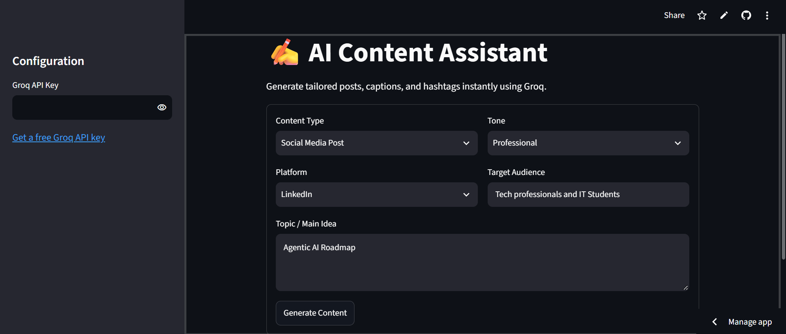
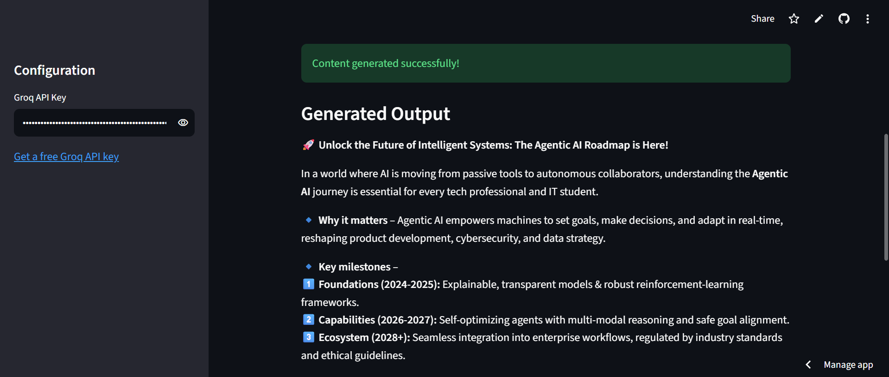
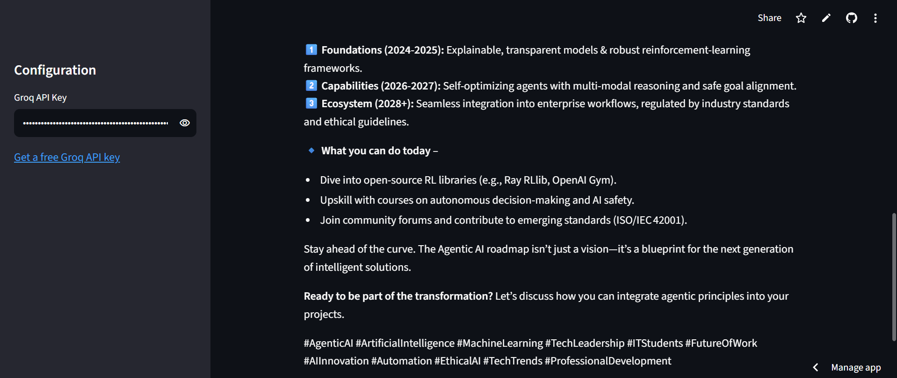
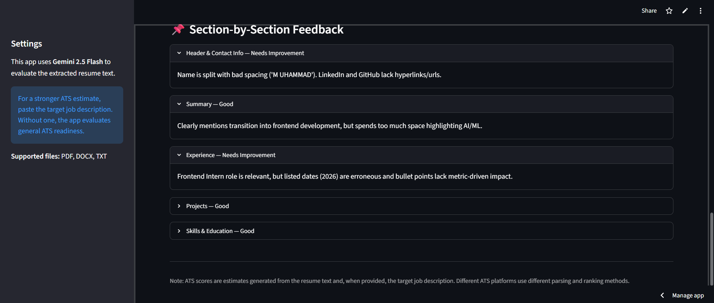
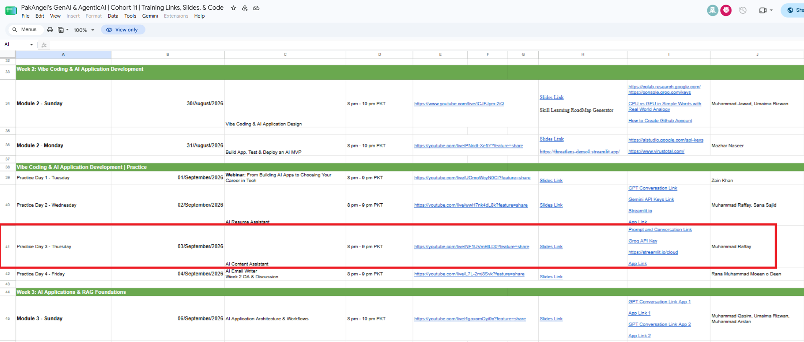

# 📝 AI Content Assistant

An AI-powered web application designed to automatically generate high-quality social media content for multiple platforms (LinkedIn, Instagram, Facebook, X/Twitter, and more) across custom topics and tailored brand tones.

This project was built and showcased during an interactive live training session to demonstrate how to build and deploy practical multi-platform content creation tools using open-source LLMs.

---

## 🔗 Quick Links

* 🚀 **Live Application:** [AI Content Assistant App](https://itsrafay03-ai-resume-assistant-app-cl9m4b.streamlit.app/)
* 📺 **Session Recording:** [Watch on YouTube](https://www.youtube.com/live/wwH7nk4dL8k)
* 🌐 **Organization Website:** [PakAngels](https://www.pakangels.com/)

---

## 🌟 Community & Training Impact

I served as a volunteer **Trainer and Moderator** for [PakAngels](https://www.pakangels.com/) during their **6-Week Hands-on Training Program on Generative & Agentic AI (Cohort-11, 2026)**.

On **September 3, 2026**, I delivered my **2nd live lecture** to **450+ students** from diverse academic and professional backgrounds. The session guided students through building a real-world **AI Content Assistant** from scratch.

### Key Learning Outcomes Covered:

1. **Problem Identification:** Understanding the challenge of multi-platform social media content creation.
2. **System Architecture:** Designing prompt structures for multi-platform output (LinkedIn, Instagram, X/Twitter, Facebook).
3. **AI Integration:** Integrating high-performance open-source models (`openai/gpt-oss-120b` via Groq API) for high-speed generation.
4. **AI-Assisted Development:** Utilizing ChatGPT to write, optimize, and debug app logic efficiently.
5. **Deployment:** Pushing repository updates via Git/GitHub and hosting live on Streamlit Cloud.

---

## 🛠️ Tech Stack & Tools

* **Programming Language:** Python
* **LLM Model Engine:** `openai/gpt-oss-120b` (Groq API integration)
* **Code Assistant:** ChatGPT
* **Version Control:** Git & GitHub
* **Deployment & UI Framework:** Streamlit Cloud

---

## 📸 Application Screenshots

### 💻 App Interface

<p align="center">
  <br><br>
  <br><br>
  <br><br>
  
</p>

### 📜 Trainer Schedule & Proof of Session

<p align="center">
  
</p>

---

## 🚀 How to Run Locally

1. **Clone the repository:**
   ```bash
   git clone https://github.com/itsrafay03/Ai-Content-Assistant.git
   cd Ai-Content-Assistant
   ```

2. **Install dependencies:**
   ```bash
   pip install -r requirements.txt
   ```

3. **Set up API key:**
   Add your Groq API key in `.env` or Streamlit secrets:
   ```env
   GROQ_API_KEY="your_api_key_here"
   ```

4. **Launch the application:**
   ```bash
   streamlit run app.py
   ```

---

## 👤 Author & Workshop Trainer

**Muhammad Rafay**
* **GitHub:** [@itsrafay03](https://github.com/itsrafay03)
* **Role:** Volunteer AI Trainer & Developer | PakAngels Generative & Agentic AI Training